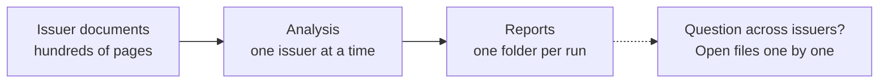
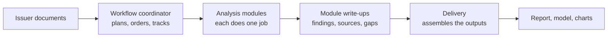
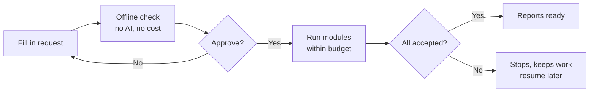
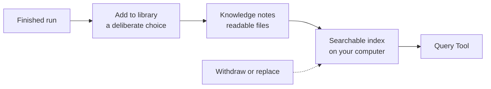
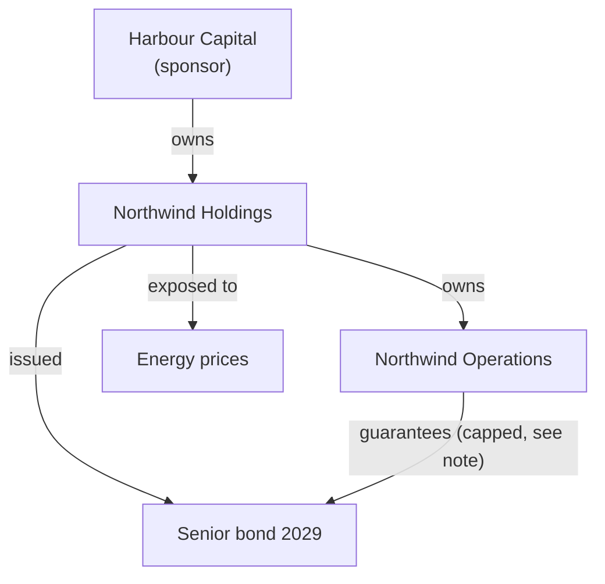
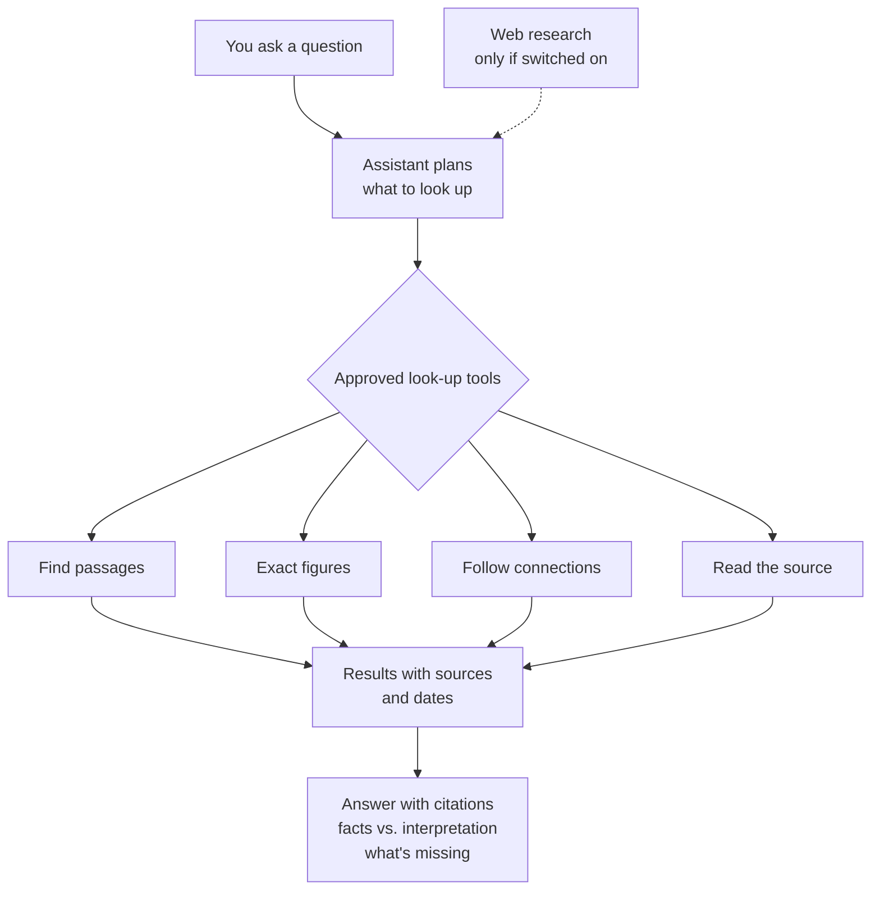
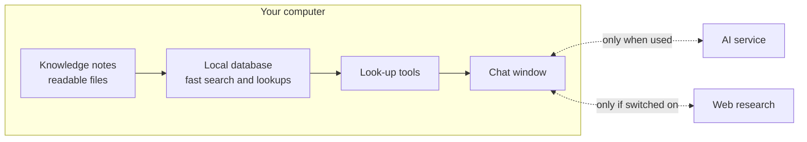
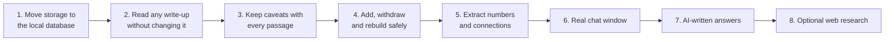

# The Issuer Library and the Query Tool

Slide content for a non-technical audience. Each slide has the text to show, a visual (diagram, table or example), and speaker notes.

Diagrams are written in Mermaid. Paste a diagram block into [mermaid.live](https://mermaid.live) to export it as an image for the slides, or redraw it with your slide tool's shapes.

Status labels used throughout:

- **Available today**: part of the current application.
- **Prototype**: built and tested on one historical case.
- **Planned**: designed, not built yet.

---

## Slide 1 — Title

**On the slide**

> From analysis to answers
> The Issuer Library and the Query Tool

**Speaker notes**

Today I'll show how our credit workflow turns an issuer's documents into finished analysis, how the Issuer Library application lets us run and read that analysis, and how a new Query Tool could let us ask questions across everything we've already analysed, in plain English.

---

## Slide 2 — The problem

**On the slide**

- Analysing an issuer means reading hundreds of pages: annual reports, bond documents, rating reports.
- Our workflow already breaks that work into focused steps and produces reports and models.
- But each analysis sits in its own folder. Answering a question across issuers still means opening files one by one.

**Visual**



**Speaker notes**

The first two steps are solved. The last step, finding and comparing what we already know, is what the Query Tool is for.

---

## Slide 3 — The workflow in one picture

**On the slide**

1. We provide the issuer's documents.
2. A coordinator decides which analysis steps to run, and in what order.
3. Each step (a "module") does one job and writes up its findings.
4. A delivery step assembles those write-ups into the final report and model.

**Visual**



**Speaker notes**

Think of it as a team of specialists with a project manager. The coordinator is the project manager. Each specialist hands a written note to the next one. The delivery step turns those notes into the finished product. Nothing in the final report is invented at the delivery stage: it comes from the specialists' notes.

---

## Slide 4 — The analysis modules

**On the slide**

Each module is a specialist with one job.

| Stage | Modules |
|---|---|
| Getting the facts straight | Source readiness · Financial data foundation · Business and transaction facts · Earnings changes · Earnings quality · Financial change screen |
| Context | Deep research · Peer comparison |
| Credit judgement | Fundamental credit view · Downside scenarios · Liquidity and cash flow bridge · Currency and hedging sensitivity · Forward credit model · Rating change triggers |
| Securities and legal terms | Relative value · Market-implied risk · Refinancing risk · Legal and covenant review · Restructuring position |
| Checks and challenge | Evidence check · Investment committee challenge · Comparison with earlier runs |

**Speaker notes**

You don't need to remember these. The point is that the work is split into small, checkable pieces. Not every module runs for every issuer: the coordinator picks the ones the request needs. The last group matters for trust: one module checks that every claim traces back to a source, one argues the other side, and one explains what changed since the last time we looked at this issuer.

---

## Slide 5 — The Issuer Library application

**Available today**

**On the slide**

One place to run, read and check issuer analysis.

- **Library**: every past run, filterable by sector, workflow, leverage and interest coverage.
- **New run**: choose the issuer, dates, files, AI model and a spending limit.
- **Reports**: open finished reports, see exactly which module write-ups each was built from.
- **Evidence**: click a finding or a chart point to see the source behind it.
- **Run activity**: see progress, spending, and why a run stopped.

**Visual (screen layout sketch, illustrative values)**

```text
+------+------------------------------------------------------+
| Menu |  Issuer Library                     [ All reports ] [ New run ] |
|      |------------------------------------------------------|
| Lib  |  Search issuer, run or sector...    [Sector v] [Workflow v]      |
| Work |  -------------------------------------------------------------- |
| Rpts |  Issuer        Sector      Leverage   Coverage   Report           |
| Runs |  Issuer A      Gaming      4.2x       2.1x       Available        |
| New  |  Issuer B      Autos       --         --         Not yet          |
+------+------------------------------------------------------+
```

**Speaker notes**

Note the dashes: when a number isn't available, the app shows that it's missing rather than showing zero. That rule runs through everything you'll see today.

---

## Slide 6 — What happens when you start a run

**Available today**

**On the slide**

1. Enter the request: issuer, workflow, dates, files.
2. **Check before spending**: the app shows, without calling any AI, which modules will run, which files can't be read and which report sections won't be produced.
3. Approve, then start. Only now can the AI be used, within the spending limit you set.
4. If a module's output is rejected, the run stops and keeps its work. No automatic paid retry.
5. A stopped run can be resumed without redoing the modules already accepted.

**Visual**



**Speaker notes**

Two safeguards: you see what you'll get before anything costs money, and a failure never silently spends more.

---

## Slide 7 — What a module write-up looks like

**On the slide**

Every module hands over a short, structured note with the same six parts.

| Part | What it holds |
|---|---|
| Request | What this module was asked to do |
| Sources | Which documents and pages it used |
| Findings | What it concluded |
| Calculations | The numbers it worked out, and how |
| Gaps | What it couldn't find or confirm |
| Next module | What the next specialist should know |

**Example (illustrative, shortened)**

```text
Findings
  Funding coverage (sources ÷ needs) under the published plan: 1.20x
  (relies on a planned bond that had not been issued at the time)

Gaps
  Individual guarantee amounts and caps were not examined.

Sources
  Funding plan, page 12; rating agency report, page 3
```

**Speaker notes**

These notes are what the Query Tool learns from. Notice that a number never travels alone: it comes with its condition ("relies on a planned bond") and its source.

---

## Slide 8 — The gap: our knowledge is spread across runs

**On the slide**

Questions we can't answer quickly today:

- "Which gaming issuers rated B2 or below have the highest leverage?"
- "Which issuers are most exposed to rising energy prices, and why?"
- "Who guarantees this issuer's bonds?"
- "What changed since our last analysis of this issuer?"

Each one means opening several reports and comparing them by hand.

**Speaker notes**

The answers already exist in our module write-ups. They're just not connected. The Query Tool connects them.

---

## Slide 9 — Introducing the Query Tool

**Prototype / Planned**

**On the slide**

A chat assistant over the analysis we've already done.

- Ask in plain English; ask follow-up questions.
- Answers come with sources you can click through.
- Tables, charts and relationship maps when they help.
- Optional web research, clearly kept apart from our own analysis.

**Visual (screen layout sketch)**

```text
+--------------+---------------------------------------------+
| New chat     |  You: Which gaming issuers have the highest |
| History      |       leverage?                             |
| Library      |                                             |
|              |  Assistant: Three issuers in the library    |
|              |  are gaming companies with leverage on the  |
|              |  same basis. [table]  Sources: [1] [2] [3]  |
|              |  Not included: Issuer D (different basis)   |
|              |---------------------------------------------|
|              |  [ Ask a question...        ] [Library v] ▶ |
+--------------+---------------------------------------------+
```

**Speaker notes**

It looks like the chat assistants you already know. The difference is what it's allowed to answer from: only analysis we've deliberately added to the library, plus the web only if you switch it on.

---

## Slide 10 — How the knowledge gets in

**Planned (prototype covers one case)**

**On the slide**

1. A run finishes and someone reviews it.
2. They choose **Add to library**. Nothing enters automatically.
3. The tool turns the write-ups into knowledge notes: facts, numbers, connections, explanations.
4. It files them in a searchable database on your own computer.
5. If an analysis is withdrawn or replaced, answers stop using the old version.

**Visual**



**Speaker notes**

The original write-ups are never changed. The knowledge notes are plain, readable documents, so a person can open and check them. The database is just a fast index of those notes: if it's ever lost, it can be rebuilt from them.

---

## Slide 11 — Two kinds of information

**On the slide**

| | Numbers and facts | Explanations |
|---|---|---|
| Examples | Leverage 4.2x, a B2 rating, a bond's maturity, "Company X guarantees Bond Y" | "Margins are exposed to energy costs because…" |
| Best for | Ranking, filtering, comparing | Understanding why |
| How the tool uses it | Exact lookups and calculations | Finding the relevant passages |
| Main risk | Comparing things that aren't comparable | Losing the caveat that came with the text |

**Speaker notes**

Most good answers need both: the numbers to rank issuers, then the explanations to say why. The tool keeps them linked: every number points back to the passage it came from.

---

## Slide 12 — A number never travels alone

**On the slide**

"4.2x" means nothing without its context. Every number is stored as a card with its context attached.

**Example card (illustrative)**

| Field | Value |
|---|---|
| Issuer | Northwind Holdings (fictional) |
| Measure | Leverage (debt ÷ earnings) |
| Value | 4.2x |
| Basis | Net debt, company-adjusted earnings |
| Period | Financial year 2025 |
| Currency | EUR |
| Kind | Reported by the company |
| Source | Annual report 2025, page 48 |
| As of | 14 March 2026 |
| Caveats | Excludes leases |

**Speaker notes**

Two leverage figures on different bases look comparable but aren't. Because the basis is on the card, the tool can refuse to rank them together and tell you why, instead of producing a misleading league table. And if a value is missing, the card says "missing" and gives a reason. It never becomes zero.

---

## Slide 13 — The knowledge map

**On the slide**

The tool also records how things are connected: who owns whom, who guarantees what, who issued which bond.

**Visual (illustrative, fictional companies)**



**Speaker notes**

Each arrow is a specific kind of relationship with a date and a source. "Owns" and "guarantees" are different things, and a guarantee with a cap is recorded with its cap, not as an unlimited guarantee. This is what lets the tool answer "who stands behind this bond?" or "which issuers share a sponsor?"

---

## Slide 14 — Finding things by meaning, not just by words

**Planned**

**On the slide**

- Today the prototype finds passages that contain your words.
- The plan adds search by meaning, so related wording is found too.

**Example**

| You ask about | Word search finds | Search by meaning also finds |
|---|---|---|
| "energy cost exposure" | Passages containing "energy" and "cost" | "Fuel price sensitivity", "power tariffs squeeze margins" |

- Search by meaning helps the tool **find explanations**. It is never used to rank issuers. Rankings always use exact numbers.

**Speaker notes**

We only add this if testing shows word search is missing relevant passages. It will run on your own computer, so our analysis isn't sent anywhere just to be searched.

---

## Slide 15 — What happens when you ask a question

**Prototype (tools) / Planned (AI answers)**

**On the slide**

1. You ask in the chat.
2. The assistant decides what it needs to look up.
3. It uses a small set of approved look-up tools: find passages, get exact figures, follow connections, read the original source.
4. Before every look-up, the tool checks the analysis is still current and unchanged. If not, it refuses rather than guessing.
5. The assistant writes the answer with sources, and says what it couldn't cover.

**Visual**



**Speaker notes**

The assistant can only look things up; it can't change the analysis, run new modules or spend beyond a set limit. If a question reveals a gap in our analysis, the right response is a request back to the workflow coordinator to fill it, not the assistant making something up.

---

## Slide 16 — A worked example

**Prototype, historical test case (April 2024 data). Not a current view.**

**On the slide**

> **Question:** "How well do this issuer's funding sources cover its needs?"

1. The assistant finds the funding passage in the module write-ups.
2. It fetches the exact figures:
   - **1.20x** if the planned bond is issued
   - **1.03x** without the planned bond
3. It opens the source lines to confirm both numbers and their conditions.
4. The answer gives both figures, explains that the higher one depends on a bond not yet issued, and cites the source and date.

**Speaker notes**

This is a real test from the prototype, using a historical case from April 2024. The point isn't the issuer: it's that the tool kept the condition attached to the number. A careless summary would just say "1.20x coverage".

---

## Slide 17 — Built-in safeguards

**On the slide**

| Safeguard | What it means for you |
|---|---|
| Sources on every answer | You can click through to the page it came from |
| Missing is never zero | Gaps are shown as gaps, with a reason |
| Like-for-like only | Numbers on different bases or currencies aren't ranked together |
| Facts vs. interpretation | The answer says which is which |
| Library is opt-in | Unfinished or experimental work is never used |
| Withdrawn means gone | Replaced or withdrawn analysis stops being used |
| Web kept separate | Web findings are labelled with their link and date, and never overwrite our analysis |
| Look-up only | The assistant can't change the analysis or the database |

---

## Slide 18 — Where it all lives

**On the slide**

- Runs on your own computer. No cloud database.
- Browsing, searching, the knowledge map and saved conversations work offline.
- An internet connection is needed only for AI-written answers and for web research when switched on.
- Data is stored in a standard database (PostgreSQL) on the same computer, built from readable notes that people can open and check.

**Visual**



**Speaker notes**

When an AI service is used, only the passages needed for that answer are sent, not the whole library.

---

## Slide 19 — Where we are today

**On the slide**

| Piece | Status |
|---|---|
| Analysis workflow and modules | Available |
| Issuer Library application | Available |
| Query Tool look-up tools | Prototype, tested on one historical case |
| Knowledge map and number cards | Prototype, one hand-prepared case |
| Chat window | Prototype with scripted answers |
| AI-written answers | Planned |
| Search by meaning | Planned, only if testing shows it's needed |
| Web research | Planned |
| Automatic extraction from any write-up | Planned |

**Speaker notes**

The prototype proves the tools work and keep their safeguards. It doesn't yet have an AI writing answers, and it has only been tested on one historical issuer.

---

## Slide 20 — The road ahead

**On the slide**

Small steps, each with something you can see working.



**Speaker notes**

Each step ends with a demonstration on real past analysis, not just passing tests. AI answers come late on purpose: the foundations (correct numbers, caveats and sources) have to be right first.

---

## Slide 21 — What the company gains

**On the slide**

| Outcome | How it happens |
|---|---|
| **Faster answers** | Questions that take an afternoon of opening reports become a short conversation with sources attached |
| **Knowledge that compounds** | Every finished analysis added to the library makes the next question easier to answer. Work is reused, not redone |
| **More consistent decisions** | Issuers are compared like-for-like, with the same definitions, and mismatches are flagged instead of hidden |
| **Easier to check and explain** | Every answer traces back to a page and a date, which supports reviews, committees and audit |
| **Less reliance on memory** | What one analyst learned stays findable after they move on |
| **Lower risk with AI** | The assistant only reads approved, reviewed analysis, keeps caveats attached and runs on our own computers |
| **Controlled cost** | Look-ups and browsing cost nothing to run; AI is used only to write answers, within set limits |

**Speaker notes**

The main benefit isn't speed on a single question. It's that our analysis becomes an asset that grows: the more we analyse, the more the library can answer, and the better new analysis can build on old. We haven't measured time savings yet; the roadmap's demonstrations are where we'd start.

---

## Slide 22 — Day-to-day use cases

**On the slide**

| Who | Example question |
|---|---|
| Credit analyst | "What did we conclude about this issuer's liquidity last time, and what has changed since?" |
| Portfolio manager | "Which issuers in the portfolio have bonds maturing in 2027 and coverage below 1.5x?" |
| Investment committee | "Show me the strongest argument against this recommendation, with sources." |
| Risk team | "Which issuers are exposed to a rise in energy prices, and how severe is it for each?" |
| New team member | "Explain this issuer's group structure and who guarantees the bonds." |

**Speaker notes**

Same tool, different people. Each question is answered from the same reviewed library, so everyone works from the same facts.

---

## Slide 23 — Beyond today's use case

**On the slide**

The same approach (reviewed documents in, connected knowledge, questions answered with sources) could serve other teams.

| Area | What could go into the library | Example question |
|---|---|---|
| Portfolio monitoring | Quarterly results and covenant tests across holdings | "Which holdings are getting close to a covenant limit?" |
| Early-warning alerts | New results compared with our last analysis | "Tell me when leverage moves past our last base case." |
| Legal and documentation | Bond terms, loan agreements, amendments | "Which deals let the borrower move assets away from lenders?" |
| Sector and thematic research | Findings across issuers in one industry | "How exposed is the gaming sector to tax changes?" |
| Committee preparation | Past committee papers and outcomes | "What did the committee ask last time we looked at a similar deal?" |
| Compliance and audit | Decisions with their evidence trail | "Show the sources behind this rating decision on that date." |
| Training and onboarding | Annotated past analyses | "Walk me through how we assess refinancing risk, with examples." |
| Client and management reporting | Approved findings and charts | "Draft a summary of our view on these five issuers, with sources." |

**Speaker notes**

These are possibilities, not commitments. Each would reuse the same foundations: opt-in library, sources on every answer, numbers kept with their context, and local storage. The credit workflow comes first because it already produces structured, reviewed write-ups.

---

## Slide 24 — In summary

**On the slide**

- Our workflow already turns issuer documents into reviewed analysis.
- The Issuer Library lets us run, read and check that analysis today.
- The Query Tool would let anyone ask questions across all of it, in plain English, with sources.
- The result: faster, more consistent and easier-to-check decisions, from knowledge that grows with every analysis.

---

## Slide 25 — Questions

**On the slide**

> Questions and discussion

---

## Appendix — Glossary for Q&A

Use these if someone asks for the technical name.

| Plain term on the slides | Technical term |
|---|---|
| Workflow coordinator | Orchestrator |
| Module write-up | Markdown handoff |
| Knowledge notes | OKF (Open Knowledge Format) Markdown files |
| Local database / index | PostgreSQL |
| Knowledge map | Knowledge graph |
| Approved look-up tools | MCP (Model Context Protocol) server with read-only tools |
| Finding passages before answering | RAG (retrieval-augmented generation) |
| Search by meaning | Semantic / vector search (pgvector) |
| Number card | Structured observation record |

## Appendix — Module names

| Plain name used on the slides | Module title in the workflow |
|---|---|
| Source readiness | Source readiness |
| Financial data foundation | Canonical data foundation |
| Business and transaction facts | Business transaction fact pack |
| Earnings changes | Earnings delta |
| Earnings quality | Earnings quality |
| Financial change screen | Financial change screen |
| Deep research | Deep research |
| Peer comparison | Peer benchmark |
| Fundamental credit view | Fundamental credit synthesizer |
| Downside scenarios | Downside pathway |
| Liquidity and cash flow bridge | Liquidity cash flow bridge |
| Currency and hedging sensitivity | Macro FX hedging sensitivity |
| Forward credit model | Forward credit model |
| Rating change triggers | Ratings migration trigger |
| Relative value | Relative value security selection |
| Market-implied risk | Market implied risk |
| Refinancing risk | Refinancing and liability management risk |
| Legal and covenant review | Legal covenant interpreter |
| Restructuring position | Restructuring fulcrum |
| Evidence check | Evidence trace validator |
| Investment committee challenge | IC debate challenge |
| Comparison with earlier runs | Prior/current deliverable comparison |
| Workflow coordinator | Orchestrator |
